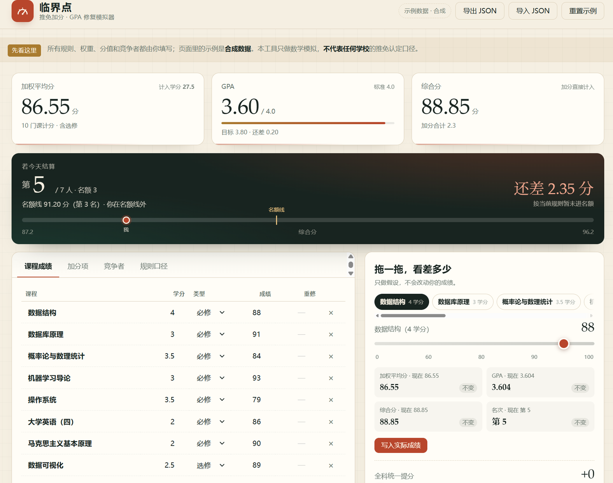

# 临界点 · 推免加分与 GPA 修复模拟器

把成绩、加分、名额和竞争者录进来，实时算出综合分、名次和「离名额线还差多少」；拖一拖「假设这门考多少」，就知道这次刷分值不值。

在线体验：<https://critical-point-95d4bo3wm4y.qoder.zone>

免注册、免登录，打开就是一份合成示例（10 门课 / 3 项加分 / 6 位竞争者 / 3 个名额），所有数据只留在自己的浏览器里。



*示例数据：综合分 88.85，第 5 / 7 名，名额线 91.20，还差 2.35 分。*

## 功能

- **实时算账**：加权平均分、GPA、综合分、名次随改随算，名额线和临界差显示在同一屏。
- **拖一拖反推**：选一门课拖动滑块，右侧同步给出 GPA、综合分、名次的前后差，确认后「写入实际成绩」。
- **加分敏感性**：新增一个奖项，排名立即更新；表格直接写明「再拿一个省一前进几名」。
- **规则自己定**：重修计不计入、取最高还是取最新、计全部课程还是只计必修、GPA 用哪种口径、学业与加分权重怎么分，全部可切换。
- **情景对比**：保存多个方案（如「保持现状」「刷两门重修」），并排比较 GPA、综合分和名次。
- **数据自主**：仅使用浏览器 `localStorage`，可导出 / 导入 JSON，可一键重置示例。

## 规则模型

- 课程：名称、学分、类型、成绩、重修成绩。
- 重修计入方式：不计入 / 取最高 / 取最新 / 取平均。
- GPA 口径：标准 4.0（90 分档）、改进 4.0（85 分档）、5.0 制（分数 ÷ 10 − 5）、百分制加权平均、自定义分段（分段表可编辑）。
- 综合分 = 加权平均分 × 学业权重 + 加分合计 × 加分权重；默认 100% / 100%，可切换 85% / 15%、90% / 10%。
- 加分项：名称、类别、分值，可设加分上限。
- 名次 = 1 + 综合分严格高于我的人数（同分同名次）；名额线 = 第「名额」名的综合分；临界差 = 我的综合分 − 名额线。

所有规则、权重和分值都是用户自填的示例，不内置任何学校口径；页面固定展示「不代表任何学校认定」。示例课程与竞争者为合成数据，不对应真实学生。

## 本地运行

需要 Node.js 18+ 和 Python 3。

```bash
npm test          # 计算内核单元测试，16 项
npm run serve     # 启动本地静态服务，默认 http://localhost:4173
```

也可以直接用浏览器打开 `dist/index.html`。

## 目录

```
dist/
  index.html      页面结构
  styles.css      样式（含 390px 移动端）
  app.js          界面与交互
  calc.js         计算内核：纯函数，不碰 DOM、不联网，可独立测试
tests/
  calc.test.mjs   Node 内置 test runner
docs/
  overview.png    README 配图
方案.md            产品说明、规则模型与验收记录
```

## 边界

- 不冒充官方，不预测政策，不抓取教务系统。
- 不做账号与云同步，数据不离开本机。
- 不覆盖挂科、缓考、五级制等特殊成绩口径，需要时请先按本校规则折算再录入。
